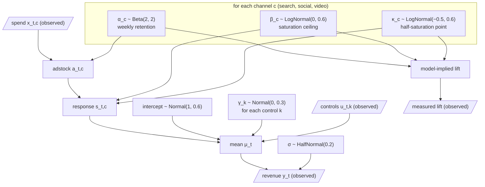

# The model

[README](../README.md) · [API](api.md) · [Warehouse](warehouse.md) · [Validation](validation.md)

This page writes down the media mix model that Foerster Marketing fits, using the Kettle & Pine example as the concrete instance.
PyMC-Marketing's `MMM` class fits the same model, and the [study](../study/README.md) checks that both compute the same density and gradient.
The [warehouse page](warehouse.md) describes the operational model that builds on it.

The whole workflow has three layers:

1. **Measurement.** A Bayesian model explains weekly revenue from spending, controls and, optionally, lift experiments. Both libraries implement it.
2. **Allocation.** The posterior chooses the best split of a fixed weekly budget across channels by expected revenue. Both libraries implement it.
3. **Operations.** A simulation of the running business turns demand into profit, given the current state of the business. In this repository that is the warehouse extension, built on Foerster's inference over application state; PyMC-Marketing has no counterpart.

## Measurement

### Graph

Parallelograms are observed; everything else is latent or derived.
The model has 15 parameters: three retentions, three ceilings, three half-saturation points, the intercept, four control coefficients and the noise scale.

### Equations

All quantities use fixed scales: spend in thousands of euros ($\tilde x = x / 1000$) and revenue in tens of thousands ($\tilde y = y / 10{,}000$).
Priors are stated in these scaled units.

**Adstock.** Advertising keeps working after the money is spent.
With six weekly lags ($L = 6$), the effective spend of channel $c$ in week $t$ is a normalised geometric average of the current and the five previous weeks:

$$a_{t,c} = \frac{\sum_{l=0}^{L-1} \alpha_c^{\,l}\, \tilde x_{t-l,c}}{\sum_{l=0}^{L-1} \alpha_c^{\,l}}$$

Spend before the first row of data is taken as zero.
Because of the normalisation, $a_{t,c}$ stays in spend units, and $\alpha_c$ only shapes how the effect is spread over time.

**Saturation.** Each additional euro buys a little less than the one before.
The Michaelis–Menten curve approaches the ceiling $\beta_c$ and reaches half of it at effective spend $\kappa_c$:

$$s_{t,c} = \frac{\beta_c\, a_{t,c}}{\kappa_c + a_{t,c}}$$

The library also offers a logistic curve, $\beta_c \tanh(\lambda_c a / 2)$, and a linear response, $\beta_c a$.

**Revenue.** Media responses, a baseline and the observed controls add up to the expected revenue, and the observed revenue scatters around it with Gaussian noise:

$$\mu_t = \text{intercept} + \sum_c s_{t,c} + \sum_k \gamma_k\, u_{t,k}, \qquad \tilde y_t \sim \text{Normal}(\mu_t,\ \sigma)$$

Kettle & Pine's controls are a demand index, a promotion indicator and an annual sine and cosine.
A Student-t likelihood with fixed degrees of freedom is also available.

### Lift experiments

The observed history cannot separate two channels whose spend always rises and falls together.
An experiment can, because it changes one channel while the others stay put.
Kettle & Pine's experiment raised video spend from EUR 1,200 to EUR 2,000 a week for four weeks and measured the extra revenue over those four weeks and the five weeks after them.

The model predicts that lift from the same media parameters.
It computes the media response along the treatment and the baseline spend paths, each with five weeks of shared history before the treatment, and sums the difference over the measured weeks with weights $w_t$ (one in the nine measured weeks, zero in the history):

$$\text{lift} = 10{,}000 \sum_t w_t \sum_c \left[ s_{t,c}^{\text{treatment}} - s_{t,c}^{\text{baseline}} \right]$$

$$\widehat{\text{lift}} = 5{,}974 \sim \text{Normal}(\text{lift},\ 1{,}500)$$

The intercept and controls cancel in the difference.
The measurement uncertainty (EUR 1,500) belongs to the experiment's estimator, not to the weekly revenue noise.
The experiment counts as independent evidence only because it was not part of the training data; it also assumes that what video does in the experiment's market transfers to the whole business.

PyMC-Marketing's built-in `add_lift_test_measurements` uses a different likelihood: it compares the saturation curve at two steady spend levels and ignores how the effect builds up and carries over during a time-limited test.
For the true parameters, the time-path lift is EUR 4,122 and the steady-state approximation EUR 3,550.
The study therefore adds the time-path likelihood to the PyMC model by hand, from the model's own adstock and saturation components.

### Inference

Both libraries sample the posterior with NUTS, which needs the gradient of the log density.
PyMC computes it with PyTensor; Foerster Marketing compiles the density and its reverse-mode gradient with Raster.
NUTS samples in unconstrained coordinates (log or logit transforms of the positive and bounded parameters), and both libraries report the parameters in their natural units.

### Names in both libraries

| Quantity | Foerster Marketing | PyMC-Marketing |
| --- | --- | --- |
| Weekly retention | `alpha` | `adstock_alpha` |
| Saturation ceiling | `beta` | `saturation_alpha` |
| Half-saturation point | `kappa` | `saturation_lam` |
| Intercept | `intercept` | `intercept_contribution` |
| Control coefficients | `control` | `gamma_control` |
| Noise scale | `sigma` | `y_sigma` |
| Adstock length | `:l-max 6` | `GeometricAdstock(l_max=6, normalize=True)` |
| Scaling | `:scaling {:channel [1000 …] :target 10000}` | `FixedScaling` for channel and target |

## Allocation

A plan is a constant weekly split $p = (p_{\text{search}}, p_{\text{social}}, p_{\text{video}})$ that spends the weekly budget $B$ within each channel's bounds.
Because advertising keeps working, a plan is judged over the four campaign weeks and the five weeks of carryover after them, starting from the actual spend history:

$$p^* = \arg\max_p\ \mathbb{E}_{\theta \mid \text{data}} \Big[ \sum_{t=1}^{4+5} \mu_t(p;\, \theta) \Big] \quad \text{subject to} \quad \sum_c p_c = B,\ \ \ell_c \le p_c \le u_c$$

The future controls are part of the decision's inputs: here, demand decays from its last observed value and there is no promotion.
`decision/allocate` solves this with exact gradients on a thinned subset of posterior draws; PyMC-Marketing's `allocate_budget` solves the same problem.

`decision/compare-plans` then evaluates the gain of $p^*$ over the current plan on every posterior draw, pairing both plans on the same $\theta$.
Its interval describes uncertainty about the response curves; it does not include the week-to-week noise of future revenue.

The optimiser maximises expected revenue.
It does not know about margins, stock, delivery capacity or risk preferences.
The [warehouse extension](warehouse.md) shows how to bring those in.
