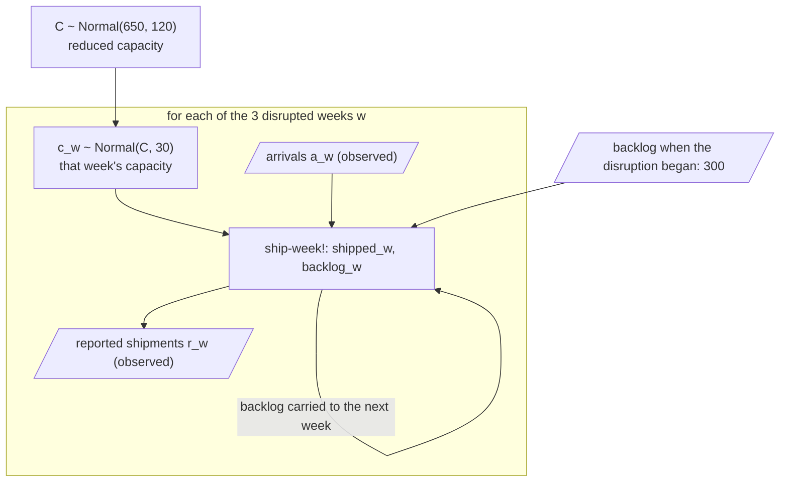
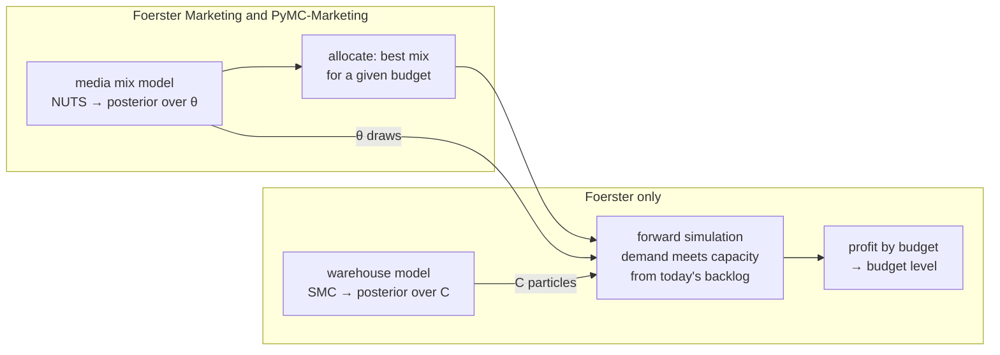

# The warehouse extension

The marketing model answers how to split a weekly budget across channels.
An operator then asks the next question: how much should we spend over the next four weeks, given the orders already waiting in the warehouse?
This extension answers it by combining the calibrated Kettle & Pine posterior with a simulation of the running warehouse.
The code is in [`examples/kettle_and_pine/warehouse.clj`](../examples/kettle_and_pine/warehouse.clj) (the warehouse model) and [`study/warehouse_study.clj`](../study/warehouse_study.clj) (the decision); the scenario is [`examples/kettle_and_pine/data/warehouse.json`](../examples/kettle_and_pine/data/warehouse.json).

## Inputs

- **Demand.** The full Foerster Marketing posterior of the calibrated case. For each of 1,000 decision draws and every candidate plan, `decision/plan-responses` gives the weekly conditional-mean revenue over the four campaign weeks and five carryover weeks.
- **Candidate plans.** Weekly budgets of EUR 0 to 7,500 in steps of 1,250. Each uses the posterior-optimal channel mix from `decision/allocate`, with channel bounds scaled in proportion to the budget.
- **Economics (synthetic).** Average order value EUR 45, contribution margin 40% before advertising, EUR 4 per order per week of delay for compensation and support, and 15% of waiting orders cancelling each week. Advertising spend is subtracted at face value.
- **Warehouse state.** A Spindel atom holds the backlog (300 orders when the disruption began, 681 now) and the three disrupted weeks of arrivals and reported shipments. Normal capacity is 900 orders a week. A staffing shortage reduced it three weeks ago, and the operations plan restores it after three more weeks.
- **Marketing model.** The [media mix model](model.md) and its allocation, which this extension uses unchanged.

## Inferring capacity

The current reduced capacity $C$ is unknown.
Each disrupted week's actual capacity varies around it, and the application's own `ship-week!` function moves the warehouse forward one week:

$$c_w \sim \text{Normal}(C,\ 30), \qquad \text{shipped}_w = \min(\text{backlog}_{w-1} + a_w,\ c_w)$$

$$\text{backlog}_w = (1 - 0.15)\,(\text{backlog}_{w-1} + a_w - \text{shipped}_w), \qquad r_w \sim \text{Normal}(\text{shipped}_w,\ 5)$$

The minimum is where the information comes from.
In a week with spare capacity, shipments equal arrivals and say nothing about $C$; in a backlogged week they measure it.
The same reports would mean something different if the backlog were ignored, which is why the inference starts from the warehouse's actual state.

The model is written as ordinary Clojure: a Spindel `spin` that calls `sample`, `observe` and `ship-week!`, which updates a Spindel atom holding the warehouse.
Foerster runs SMC over it with `:world-policy :fork`, so each of the 4,000 particles executes `ship-week!` in its own fork of the live warehouse, and the caller's atom is never changed.
SMC needs no gradients, so the same approach works for queues, discrete decisions and business rules that NUTS cannot handle.
This problem is small enough to check by grid quadrature, which `study/warehouse_check.py` does; the point of running it through Foerster is that the business logic does not have to be rewritten as a model graph.

## Deciding the budget

For each weekly budget $b \in \lbrace 0, 1{,}250, \dots, 7{,}500 \rbrace$:

1. `decision/allocate` chooses the channel mix $p_b$ that maximises expected revenue at that budget, with channel bounds scaled in proportion to $b$ (the [allocation](model.md#allocation) of the marketing model).
2. For each of 1,000 marketing posterior draws $\theta$, `decision/plan-responses` gives the weekly expected revenue $\mu_t(p_b; \theta)$ over the four campaign weeks and five carryover weeks. Orders arrive at $\mu_t / 45$ a week.
3. Each draw is paired with a capacity particle $C$ (resampled to equal counts with a fixed seed). Capacity stays reduced, $c_t \sim \text{Normal}(C, 30)$, for three more weeks and returns to 900 afterwards.
4. Starting from today's backlog of 681 orders, `ship-week!` runs the nine weeks forward in a fork of the current state, and the run is scored:

$$\text{profit}(b) = 0.40 \cdot 45 \sum_t \text{shipped}_t \;-\; 4 \sum_t \text{backlog}_t \;-\; 4\,b$$

The study reports the mean and 90% interval of profit for each budget and of the paired difference against keeping EUR 5,000 a week.
It repeats the calculation from an empty warehouse at normal capacity to show how the recommendation changes.

## How the pieces connect

Two simplifications keep this tractable, and both are worth stating when the result is used:

- **Separate fits.** The marketing posterior is computed first and treated as fixed input; shipments never feed back into the marketing model, and demand and capacity uncertainty are treated as independent.
- **Two-stage decision.** The channel mix at each budget comes from the revenue-only allocation, and the simulation chooses only the budget level. Optimising the mix directly against profit would put the simulation inside the optimiser.

## Checks

1. The caller's warehouse atom is unchanged after inference and evaluation, and every particle history is valid.
2. The capacity posterior mean agrees with an independent grid quadrature (`study/warehouse_check.py`) within three Monte Carlo standard errors, for three seeds.
3. An independent NumPy reimplementation of fulfilment and profit, reading the same exported revenue paths and capacity draws, reproduces every plan's mean profit to a relative error of 1e-8.
4. The hidden truth is used only afterwards, to report how far each recommendation is from the truth-optimal budget.

## Result

All checks pass.
The capacity posterior means for seeds 17, 31 and 73 (551.1, 555.0 and 550.5 orders a week) lie 0.6, 1.8 and 0.7 Monte Carlo standard errors from the quadrature reference of 552.1 (SD 17.4); the hidden truth is 560.
The NumPy reimplementation reproduces every plan's mean profit exactly.

Mean campaign profit relative to keeping EUR 5,000 a week, in EUR:

| Budget (EUR/week) | Empty warehouse | With backlog |
| ---: | ---: | ---: |
| 0 | −17,157 | −3,392 |
| 1,250 | −5,490 | +3,539 |
| 2,500 | −1,146 | **+4,318** (90%: 3,049 to 5,403) |
| 3,750 | **+242** (90%: −349 to +815) | +2,687 |
| 5,000 | 0 | 0 |
| 6,250 | −1,263 | −3,169 |
| 7,500 | −3,220 | −6,772 |

With an empty warehouse, EUR 3,750 a week is best and practically level with EUR 5,000.
With the backlog, EUR 2,500 is best.
Under the hidden truth, EUR 2,500 is also best with the backlog (EUR 4,393 above EUR 5,000), and EUR 3,750 without it.
The full table is in [`report.json`](../results/kettle-and-pine/warehouse/report.json).

The random draws of the SMC inference are seeded from the seeds above and from the source location of each draw in `warehouse.clj`, so editing that file above the draws changes the exact numbers, though not the conclusions.

## Limits

The warehouse, its costs and the disruption are synthetic.
Capacity and demand uncertainty are treated as independent.
The decision covers the budget level only, not its timing; delaying the campaign would be a natural next option.
The marketing model is fitted in batch with NUTS; updating it with SCMC as weekly data arrive is not part of this study.
